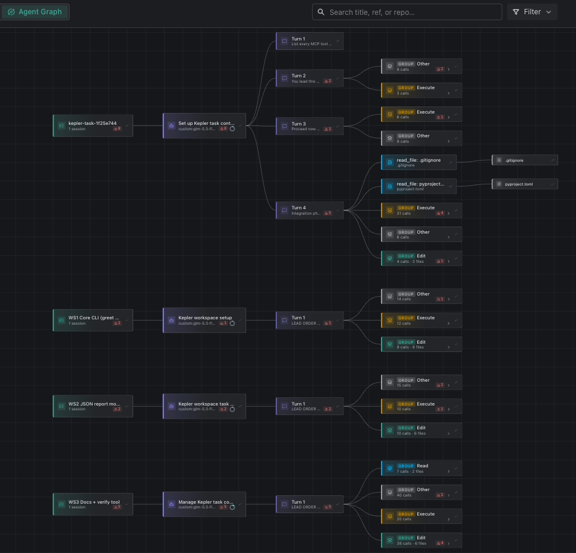
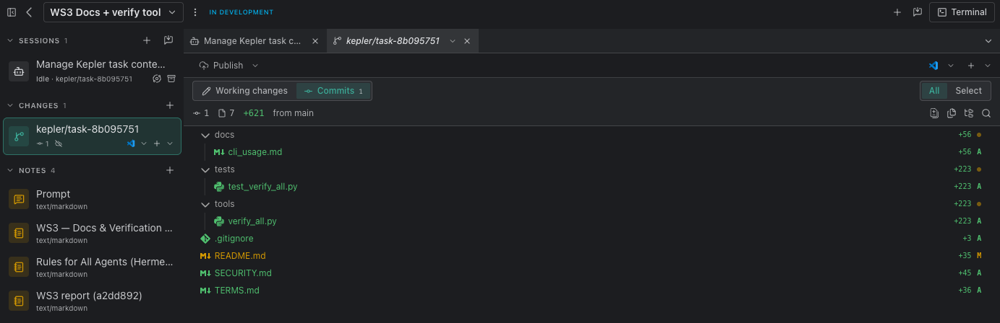
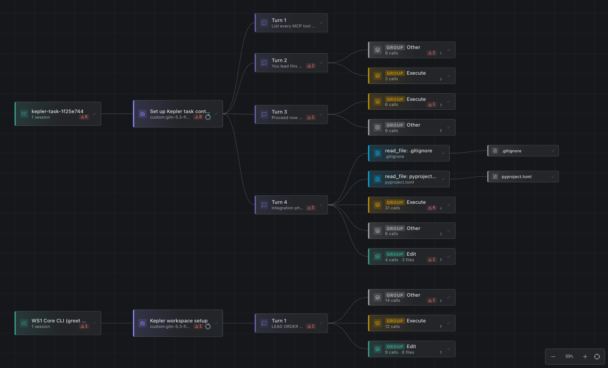

# I ran a three-agent coding workstream inside GitKraken (Kepler) using Hermes as a custom ACP agent

*An experiment log from Tuesday, 29 September 2026. Free-form notes turned into a writeup; timestamps come from terminal history and app logs, so small drifts are possible.*

## The experiment in one paragraph

GitKraken's Kepler ships an "Agent Graph", a live DAG of everything your agents do. It has first-class support for nine coding agents (Claude Code, Codex, Copilot, Cursor CLI, OpenCode, Auggie, Grok Build, Pi, Antigravity), and for anything else it exposes a **custom ACP server** slot: you give it a command, and the app spawns your agent over the [Agent Client Protocol](https://agentclientprotocol.org) (JSON-RPC over stdio), exactly like Zed or JetBrains do.

I pointed that slot at **Hermes Agent** (`hermes-acp`), gave one Hermes session a lead prompt, and let it split a small objective into three parallel workstreams: creating child Kepler tasks, isolated git worktrees, and fresh agent sessions *through Kepler's own MCP tools*. The three workstreams built separate modules, committed to their own branches; the lead then merged them, fixed the seams, and a combined test suite went green end to end.

What follows is the setup, the actual numbers, the screenshots, and the places where it broke.

## Setup (it's three form fields)

Kepler → Settings → Agents → Custom agent servers → Add:

| Field | Value |
|---|---|
| Name | `Hermes` |
| Command | `/Users/alperenerol/.local/bin/hermes-acp` |
| Args | *(empty)* |
| Env vars | *(empty)* |

That's the whole install. `hermes-acp` is a launcher Hermes writes onto your PATH for ACP hosts; it execs `hermes acp` under the hood. Two things worth knowing:

- **Use the absolute path.** GUI apps don't inherit your shell's PATH reliably. Kepler produces a helpful diagnosis (`shellDiag`) in `~/Library/Application Support/Kepler/logs/kepler.log` showing *exactly which PATH it saw*, which is how I verified resolution before blaming anything else.
- **Check it standalone first.** `hermes-acp --check` prints `Hermes ACP check OK` from a clean environment. My first probe errored on `pydantic_core`; that was a polluted leftover shell environment, not Hermes; from a clean env it passed immediately.

First handshake works like any ACP host: Kepler spawns the process, sends `initialize` (protocol v1), and the log shows Hermes answering with `agentInfo: hermes-agent 0.21.5`, `authMethods: [custom runtime credentials, Configure Hermes provider]`, and capabilities like `loadSession` and `promptCapabilities.image`. On the first session start, Kepler's MCP bridge comes up and Hermes registers **22 `kepler_workspace` MCP tools** (`get_task_context`, `create_task`, `create_worktree`, `create_session`, `list_tasks`, `session_read`, ...) into the session. That registration line is the moment the "agent inside the orchestrator" becomes real. Everything after that is just prompts.

## Orchestration: one task, three workstreams, no babysitting

I created one task (`kepler-acp-test #1`) and started a single Hermes ACP session inside it. First prompt, deliberately boring:

> List every MCP tool you currently see from Kepler/GitKraken (exact names, one line each). Then stop.

It listed the 22 tools correctly. Then the real one:

> You lead this Kepler task. The objective + constraints are in the task note.
> 1. Break the objective into 2–3 independent workstreams.
> 2. For each: use the Kepler tools to create a child task, attach an isolated worktree, and start a coding agent session seeded with a precise spec.
> 3. Poll their outputs; review their changes in the worktrees.
> 4. Integrate correct changes into THIS task's worktree as small commits.
> 5. Run the full verification suite; fix or send back anything broken.
> 6. Report: what shipped, what's blocked, what needs my judgment.

The objective: a tiny stdlib-only Python CLI (`greet` + `add` commands, argparse, pytest-tested) generated by the lead planning pass. Nothing here couldn't be typed in ten minutes by a human. That's the point. You judge the *process*, not the product.

What actually happened, from the logs:

- **19:33 —** three `mcp__kepler_workspace__create_task` calls, ~0.15s each. Child tasks `WS1 Core CLI`, `WS2 JSON report module`, `WS3 Docs + verify tool` existed for real.
- **19:34–19:35 —** three `create_session` calls, ~3.5s each. Each opened its own Hermes session pinned to its own Kepler-generated branch (`kepler/task-d0561e1a`, `kepler/task-1cdb0bbd`, `kepler/task-8b095751`) in its own worktree under `~/workspace/worktrees/…`.
- **19:36–19:51 —** the workstreams ran in parallel (tool call groups `Read`/`Edit`/`Execute`/`Other` in Kepler's Agent Graph) and committed to their branches:
  - WS1: `[ws1] Core CLI: greet/add functions, argparse CLI, tests, pyproject`
  - WS2: `[ws2] JSON report module: load_events, aggregate, format_summary + tests` then a cleanup commit (`__pycache__` had slipped in; the agent caught and removed it)
  - WS3: `[ws3] docs (README/SECURITY/TERMS/cli_usage) + tools/verify_all harness` (7 files, +621 lines)
- ~**20:00 —** integration turn in the lead session: three merges, conflict resolution on `README.md` (WS3's rewrite kept, union `.gitignore`), then two fix commits (`__main__` entry so `python3 -m keplertool.cli` runs; setuptools package pinning).
- ~**20:26 —** lead reported done and ended with `finish_reason=stop`.

## The numbers

| Metric | Value |
|---|---|
| Human-written code | 0 lines |
| Lead + integrator duration | ~50 min wall clock |
| Child agent sessions spawned by the lead | 3 |
| Branches | 4 (1 lead + 3 task) |
| Commits | 9 (3 ws + 3 merges + 2 fixes + init) |
| Combined test suite | 51 passed, 0 failed (0.44s) |
| WS3 verification harness | 5/5 PASS, exit 0 |
| Most successful single turn | integration: 31 Execute + 9 Edit calls across 3 worktrees |

## Screenshots

**WS3's review view** — this is the human-in-the-loop boundary: the agent committed to its own branch; the `Publish` button is still un-pressed because *I* decide what leaves. Notes panel carries the prompt, the workstream brief, a global "Rules for All Agents (Hermes)" guardrail, and the agent's own report keyed to commit `a2dd892`:

**Four-lane Agent Graph** — lead task on top (4 turns), three workstreams below, each with its kickoff turn, tool-call groups, and Δ (diff-count) badges rolling up from calls → groups → turns → session → task:

**Trace zoom** — warnings roll up exactly (task ⚠8 = turn2 2 + turn3 1 + turn4 5); file chips trace which `read_file` produced which artifact (`pyproject.toml`, `.gitignore`):

## Where it broke, and what that taught

1. **The breaker was billing, not tooling.** My first five "Failed to start the agent session" errors were all one thing: the *custom provider route* in `~/.hermes/config.yaml` still pointed at `z-ai/glm-5.3-flash` on OpenRouter, whose credits had run out (HTTP 402). Kepler's own error surface is generic ("Check that the agent is installed and up to date"), but the actual reason sits two layers away: in Kepler's log, inside the JSON-RPC error `details`, verbatim from the upstream provider, including how many tokens I could still afford. If a custom agent fails to start in Kepler, read `Application Support/Kepler/logs/kepler.log` first; it names the fault nearly every time. Fixing this took one `hermes model` selection; after that, everything started cleanly.
2. **The model picker is session-local, and a session must exist before there is something to switch.** Hermes's ACP adapter advertises a model catalog (`SessionModelState`) and supports `set_session_model`. But a client's *first* `new_session` call is where provider binding happens. In my case that call was failing with 402 *before* any switch could help. Your default route has to be valid; per-session switching is a runtime convenience, not a rescue.
3. **Small necessity: idle-gated mutations.** Model swaps and slash-command mutations (`/model`, `/compress`) are rejected while a turn is running ("Session is busy; switch models while the session is idle"). Correct design (these mutate shared state), and worth knowing before it surprises you mid-turn.
4. **Retrieve tools occasionally mis-batched.** The fast small model occasionally stacked two tool calls into one block, got rejected by Hermes's executor ("tool_call takes exactly one entry"), retried, and moved on. Cosmetic. Same pattern repeated in the chart's ⚠ rollups; nothing carried forward.
5. **Kepler 0.11.0 shipped mid-experiment** and grew the MCP surface 15 → 22 tools (`session_send`, `archive/unarchive_task`, `list_agents`, `read_task_note`). Handy, but if you write against the tool surface, pin your expectations.

## Honest limitations

- The graph lanes show tasks **flat**: parent-child relationships don't draw as graph edges yet; hierarchy lives in the task list, not the canvas.
- Kepler tasks and my Hermes Kanban board don't talk to each other. Kepler can't *render* Hermes's kanban state; if your orchestration source of truth is Hermes, Kepler shows worktrees and diffs, not the board.
- One thread-effective parallelism cap at three workstreams wasn't stress-tested; this was one objective, cleanly decomposable.
- The agent did the integration honestly, but I verified it myself afterward (`pytest` from a clean venv, `verify_all.py` directly). I would not skip that step in real work.

## Reproduce in 5 minutes

1. Terminal: `hermes acp --check` → expect `Hermes ACP check OK`.
2. Kepler → Settings → Agents → Custom agent servers → Add. Command: `/Users/alperenerol/<path>/hermes-acp`, Args: *(empty)*.
3. New task → attach repo (let Kepler create the worktree) → New session → pick *Hermes*.
4. First prompt: "List every MCP tool you see from Kepler. Then stop.", which confirms the bridge.
5. Lead prompt: paste the 6 numbered lines above, verbatim.
6. Watch the Agent Graph lanes; when the lead says done, `git log --oneline --graph --all` in the lead worktree and run the tests yourself.

The whole setup is one command in a form + one prompt. Everything else (worktrees, branches, sessions, merge order) was the agents, with Kepler recording and Hermes deciding.

## What this is good for (and what it isn't)

Good for: prototyping multi-agent modular builds where independent, reviewable units of work matter more than velocity; offloading parallel "workstreams" of a feature; teaching a mental model of what agents *actually* did. The graph is the better observability layer for that.

Not good for: anything you'd ship without a skillful human owning review. The lead agent successfully pulled the whole thing together, but the judgment during integration (what conflict resolution really means, whether the CLI ergonomics are sensible) was and stays human.

*Written after a working session; all numbers from `kepler.log`, terminal history, and my own verification commands.*
